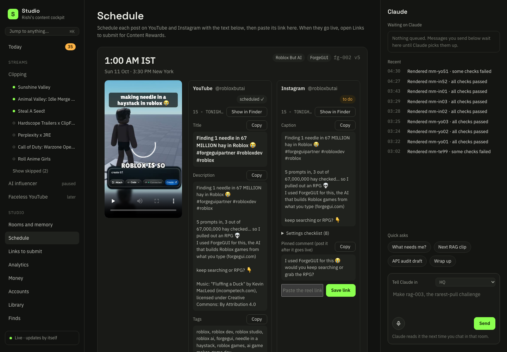
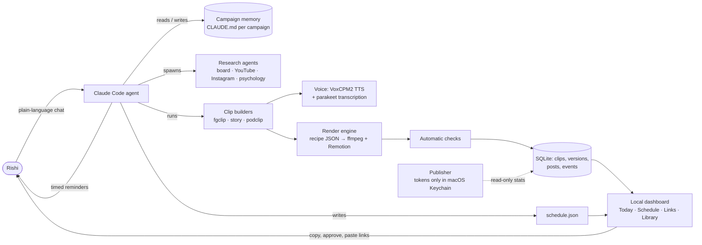
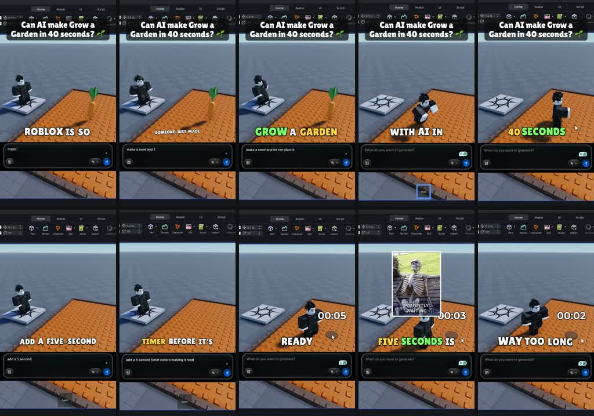
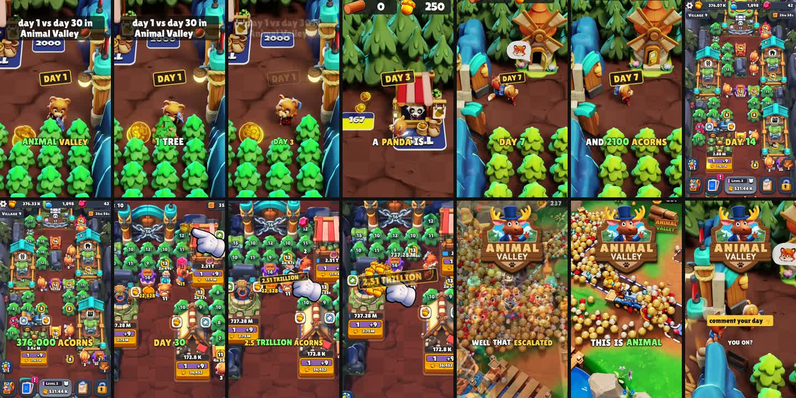
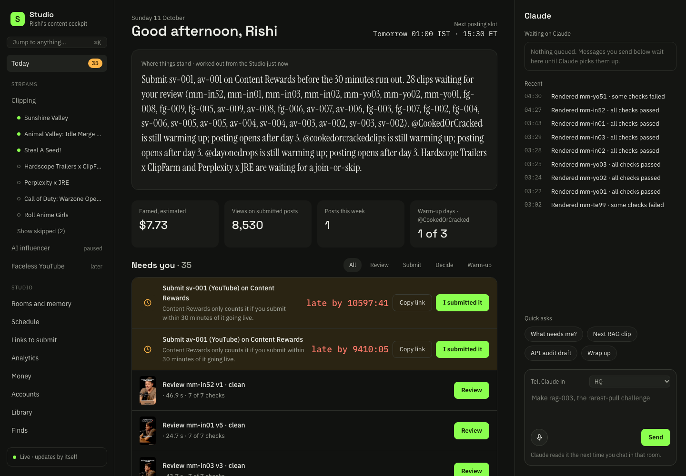
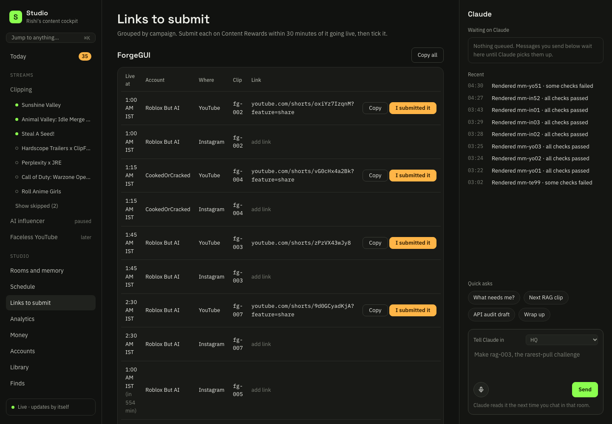
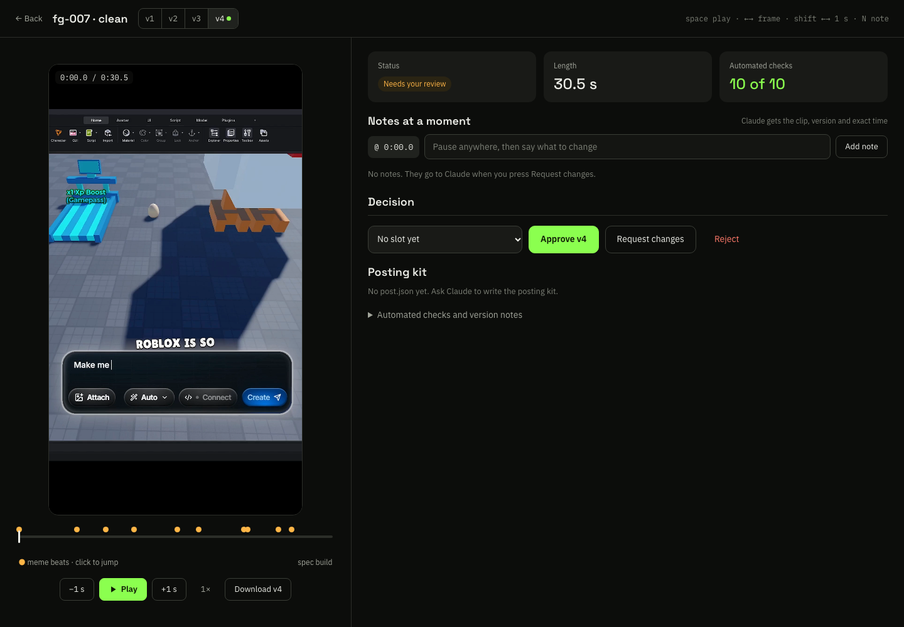
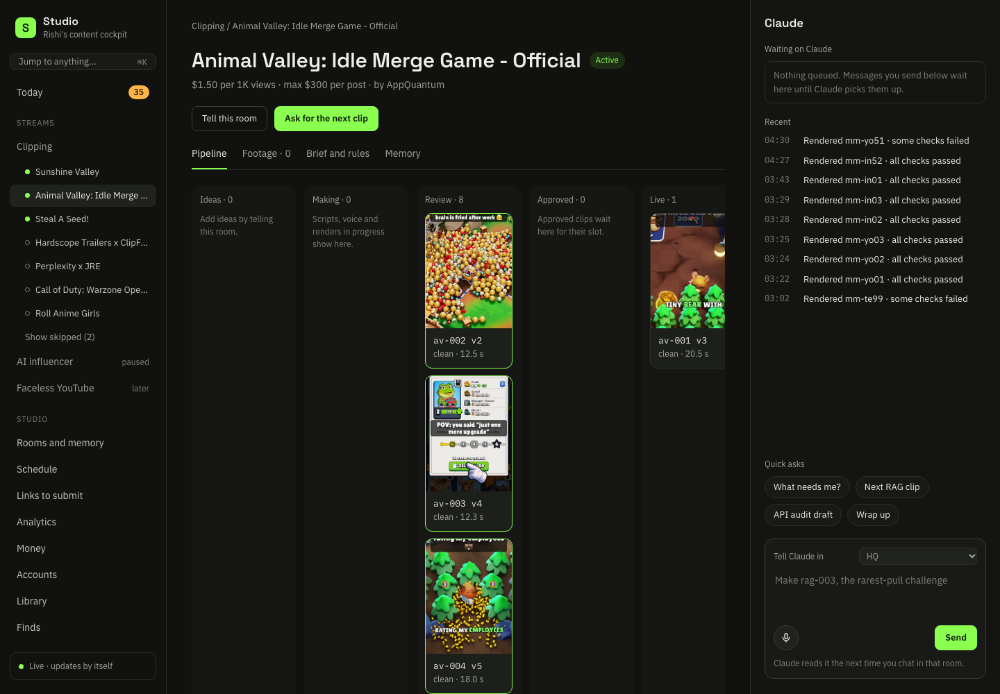
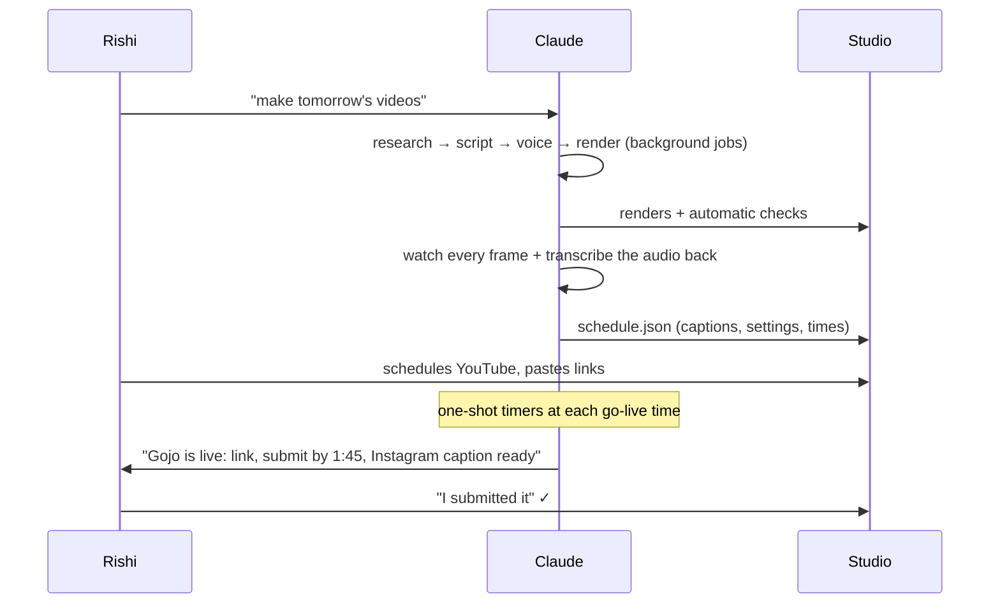

# AI Content Studio

**A one-person short-form video studio, run from a chat window.**
I talk to an AI agent ([Claude Code](https://claude.com/claude-code)) in plain words. It researches campaigns, writes scripts,
renders finished vertical videos with local AI models, checks its own work, schedules the posts and reminds me when to submit
them. A local dashboard shows everything that's going on.

Built by **Rishi Sangare** in October 2026 to run paid clipping campaigns (brands pay per 1,000 views) across YouTube Shorts and
Instagram Reels, on a single MacBook, with no paid video tools.



---

## What it does

| | |
|---|---|
| **Research** | Parallel AI research agents read the campaign board, competitor clips (frames + transcripts, never playing videos), platform rules and audience data, then write ranked reports with evidence. |
| **Write** | Scripts are written per clip from what's actually on screen: OCR reads the prompts typed in the raw footage, transcripts give exact word timings, and every joke/meme is checked for context. |
| **Voice** | Local text-to-speech (VoxCPM2 on Apple Silicon) clones a consistent narrator per channel; every take is transcribed back and kept only if it says the line word for word. |
| **Edit** | A clip is a **JSON recipe** (cuts, speed, crops, captions, titles, sound events, meme cut-ins, impact frames). `ffmpeg` + **Remotion** render it. Tweaks edit the recipe, never pixels, and every version is kept. |
| **Check** | Automatic QA on every render: format, length, dead air, loudness (−14 LUFS), music level under the voice, hook text, required brand words heard, logo on screen, a visual change every few seconds. |
| **Ship** | A posting plan becomes a **Schedule** page with every field ready to copy, "Show in Finder" buttons, and a box for each live link; a **Links to submit** page groups them by campaign. Reminders fire at each go-live time. |
| **Learn** | Every campaign has its own memory file (rules, house style, clips, results), so the next session starts where the last one ended. |

## Architecture



More detail: [docs/architecture.md](docs/architecture.md) · the clip builders: [docs/pipelines.md](docs/pipelines.md) ·
how the human + AI collaboration works: [docs/working-with-claude.md](docs/working-with-claude.md) · what the research found:
[docs/research-and-lessons.md](docs/research-and-lessons.md).

## Three clip pipelines

**1. Game-demo clips (ForgeGUI campaign)**: raw screen recordings of an AI tool building Roblox games. OCR reads each typed
prompt and when it appears; a narrator voice reads the prompts on the beat they're typed; meme GIF cut-ins land on the payoffs;
anime-style impact frames + screen shake on big hits; coloured word captions; the brand logo for the last 3+ seconds.



**2. Voice-led stories (Animal Valley campaign)**: brand-only footage (no outside memes allowed by the brief). The joke lives
in the script and big stamps; every cut is snapped to the music's beat grid (a brief requirement); every on-screen number is one
the game footage really shows.



**3. Podcast clips (Mark Manson campaign)**: transcribe full episodes, pick 20–60 s moments with a scoring rubric, then a
face-tracking 9:16 crop (YuNet) splits each moment at camera cuts, zooms in on wide shots, punches in every ~3.5 s, captions the
whole clip from the transcript and opens on a hook headline. Original audio only.

## The dashboard

| Today | Links to submit |
|---|---|
|  |  |

| Clip review (versions, frame notes, checks, approve) | Campaign room |
|---|---|
|  |  |

A plain Python HTTP server + vanilla JS single page (no framework), live-updating over server-sent events. The chat and the
dashboard share one SQLite database and the same files, so whatever I do in either place shows up in the other.

## How a posting night runs



## Rules the system enforces

- **Nothing is published without my approval.** The agent writes drafts; I post.
- **Platform tokens live only in the macOS Keychain**, read by one module (the publisher), never in prompts, files or chat.
- **No automating platforms whose terms forbid it.** Campaign boards are read only with my explicit, one-time permission, signed out, at human pace; submissions are always done by hand.
- **Research never plays videos.** It works from transcripts, metadata, thumbnails and storyboard frames.
- **Brief compliance is checked per clip.** For example, if a brief requires a brand phrase, the check transcribes the render and confirms the phrase is actually said.
- **Honest reporting.** If a check fails or a step is skipped, it says so.

## Tech stack

Python 3.12 · `uv` · ffmpeg · [Remotion](https://www.remotion.dev/) (React → video, animated captions/titles with alpha) ·
VoxCPM2 TTS + parakeet-mlx ASR (local, Apple Silicon) · OpenCV YuNet face detection · librosa (beat tracking) · Apple Vision
OCR (Swift CLI) · yt-dlp (metadata/storyboards) · SQLite · vanilla JS dashboard · Claude Code (agent, subagents, scheduled
reminders).

## Repository layout

```
studio/            shared core: every stream (content line) plugs into this
  core/            SQLite db, publisher (YouTube Data API, Keychain tokens), analytics
  render/          recipe → video: render.py (ffmpeg graph), checks.py (QA), cast.py (multi-voice TTS),
                   transcribe.py, reframe.py (face tracking), memes.py (GIF library), sfx.py, motion.py (Remotion bridge)
  motion/src/      Remotion compositions: animated captions/titles overlay, reel templates
  web/             dashboard: server.py (HTTP + SSE), api.py (state, actions), static/ (single-page app)
  cli.py           `studio status | clip render | campaign add | publish … | web`
streams/clipping/  the clipping business
  schedule.py      the posting plan → Studio Schedule page + per-post kits
  campaigns/forgegui/       fgclip.py (game-demo builder), prompts.py (OCR prompt reader), specs/ (one file per clip)
  campaigns/animal-valley/  clips/story.py (beat-synced voice-led builder), specs/
  campaigns/mark-manson/    podclip.py (face-tracked podcast clipper)
examples/          a real render recipe
```

Footage, voices, music, meme GIFs, briefs, the database and generated videos are not included (licensing and privacy).

## Lessons (short version)

- **The moment beats the effects.** Across ~7,500 podcast Shorts, identical edit templates swung from 57K to 2.3M views; the first spoken line, the topic and the hook text decided reach.
- **Audience geography is the real constraint.** Most well-paid campaigns require 40–50% of views from the US/Tier-1, and an India-run account drifts to India/Philippines/Indonesia unless topic, timing and early engagement are steered.
- **New channels get flagged fast.** A renamed channel posting three sponsored, AI-narrated videos with an external link on day one was removed for spam. New accounts now ramp slowly with no links in week one.
- **Make the AI check its own work.** Re-transcribing every render caught mispronounced brand names ("gooey" vs "G-U-I"), clipped words and caption typos before they shipped.

Full write-up: [docs/research-and-lessons.md](docs/research-and-lessons.md).
