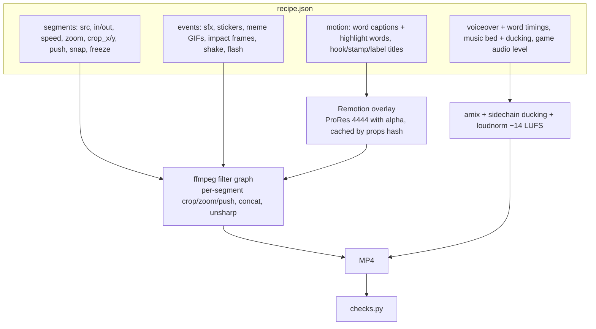

# Architecture

One shared **Studio** core, several content **streams** plugged into it, and a chat agent as the control plane.

```
studio/   ← shared: database, render engine, voice, checks, dashboard, publisher
streams/  ← one folder per content line (clipping, AI news, …); never shared code
```

## Control plane: the chat

Everything starts as a sentence in a chat with Claude Code ("make tomorrow's videos", "check this campaign", "my channel got
removed, help me appeal"). The agent works inside the project folder with the same tools a developer has: it reads and edits
files, runs Python and ffmpeg, spawns research subagents and sets timed reminders. The project's `CLAUDE.md` holds the standing
rules, so every session starts with the same ground rules (see [working-with-claude.md](working-with-claude.md)).

## Memory

| Where | What |
|---|---|
| `CLAUDE.md` (root) | Studio layout, how to work, hard rules (approval, tokens, platform terms, no-go content) |
| `streams/clipping/campaigns/<id>/CLAUDE.md` | One per campaign, under ~50 lines: brief rules, house style, footage map, clips table with versions and status, next steps |
| `streams/clipping/research/*.md` | Cross-campaign research: board scans, creator studies, audience findings, editing verdicts |
| agent memory | Short notes on how the user likes to work (e.g. "edits must make sense to a Gen-Z viewer", "pronounce ForgeGUI as G-U-I") |
| SQLite (`studio/data/studio.db`) | Campaigns, clips, clip versions, posts, metrics, events, requests, asks, finds |

## Render engine (`studio/render/`)

A clip is a **recipe**: a JSON file describing the edit. `uv run studio clip render v3.json -o out.mp4` turns it into a
1080×1920 MP4. See [`examples/recipe-fg-008.json`](../examples/recipe-fg-008.json).



Highlights:
- **Camera moves without re-shooting**: slow push-ins, "snap" impact zooms on cuts, freeze-frame holds, per-segment crops that follow a face.
- **Meme cut-ins**: a short looped GIF/MP4 with a white border popped over the edit for 1–2 s (`gif` events), fetched from Tenor's public pages into a local library (`memes.py`: search → contact sheet → pick → download).
- **Anime impact frames**: 3–5 frames flicking between inverted and hard black-and-white on a hit, snapped to the frame grid.
- **Captions**: Remotion renders word-by-word captions from the voice's word timings, with highlight colours for chosen words.
- **Audio**: voiceover lines are placed on the edit timeline (each line starts when its prompt is typed on screen); music is ducked under the voice; sound effects are layered with per-event gain and max length.

## Voice (`cast.py`, `voice.py`, `transcribe.py`)

- Narrators are **cloned from a short designed reference** (VoxCPM2), so a channel keeps one consistent voice.
- For each line the engine tries several seeds and keeps the **first take that transcribes back word for word** (parakeet-mlx).
- Word timings from that transcription drive captions, cut points and checks.
- Spelling tricks fix pronunciation (`Forge G-U-I`), and captions are normalised afterwards (`GUI`, censored swears, homophones like then/than).

## Automatic checks (`checks.py`)

Run on every render, with failures shown in the chat and on the dashboard:

`1080×1920` · length window · no dead air > N s · music audible 9–15 dB under the voice · −14 LUFS ± 1.5 · hook text from 0 s ·
speech starts within 0.5 s · required brand words actually heard (squashed match, so `G-U-I` counts) · logo/end card shown ·
a visual change at least every N s.

The agent adds a second layer by hand: contact sheets of every frame, and a transcript of the final audio.

## Builders (per campaign)

| Builder | Input | Notes |
|---|---|---|
| `forgegui/fgclip.py` | a spec: cuts (with mid-edit freezes), voice lines placed at `(cut, source time)`, typing ticks, sfx, fx (GIF / impact / shake), titles, captions, logo window | `prompts.py` OCRs the raw footage (Apple Vision) to get every typed prompt with timings |
| `animal-valley/clips/story.py` | voice lines → shots on cues (line or word), stamps, sfx, logo-on line | Cuts snap to the music's beat grid (librosa); the whole edit follows the narration |
| `mark-manson/podclip.py` | a pick: episode, start/end on sentence boundaries, hook | Face tracking per camera shot, zoom on wide shots, auto punch-ins every ~3.5 s, captions from the episode transcript |

## Dashboard (`studio/web/`)

`uv run studio web` → `http://127.0.0.1:8787`. A `ThreadingHTTPServer` with JSON endpoints (`/api/state`, `/api/schedule`,
`/api/clip/<id>`, `/api/action`), a server-sent-events stream for live updates, range requests for video scrubbing, and a
single-page vanilla JS app with hash routes. Pages: Today (brief, inbox of what needs me, countdown timers), campaign rooms
(pipeline from idea → live), clip review (versions, frame-accurate notes, checks, approve), Schedule, Links to submit,
Analytics, Money, Accounts, Library (meme sounds, music, voices), Finds.

## Publishing and analytics (`studio/core/`)

- `publisher.py`: Google OAuth (PKCE, loopback redirect) with tokens stored in the **macOS Keychain**. It can upload and schedule through the YouTube Data API, but stays read-only in practice until Google audits the project, because unaudited uploads are locked private.
- `yt_analytics.py`: per-video stats and **audience country breakdown**. That data is what showed the Tier-1 audience problem.
- Posting itself is done by hand. The Schedule page gives copy buttons for every field, and timed reminders give the link and its 30-minute submit deadline.

## Research tooling

- Campaign boards are read with one-time, signed-out, read-only browsing (Claude in Chrome). No sign-in, joining or submitting.
- YouTube is read through `yt-dlp` metadata, auto-captions and **storyboard image grids**. Videos are never played or downloaded for research.
- Instagram is read in the user's own browser, read only: grid view counts, audio labels, caption text, screenshots.
