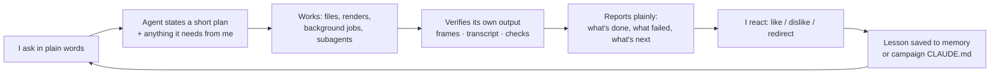

# Working with Claude: how the collaboration runs

This project is as much about **how a person and an AI agent work together** as about the code. I'm the director and the person
who presses "post"; Claude is the producer, editor, researcher and QA, working inside the project folder.

## 1. The loop

Two rules shaped every turn:
- **Act when there's enough information; ask only for decisions that are mine.** Examples of real questions: which clips were already posted, which campaign to commit to, OK to download, OK to publish. Everything with a sensible default, it just did, and said so.
- **Report outcomes faithfully.** "fg-008 failed the brand-word check: the voice said 'forge. Gooey'" beats "done".

## 2. Standing instructions instead of repeating myself

The root `CLAUDE.md` is read at the start of every session: the Studio layout, how to work on one campaign at a time, and the
hard rules. Each campaign's own `CLAUDE.md` is that campaign's memory. When I gave feedback, it went into memory so I never had to
say it twice. Some real entries:

- "Edit taste: no gimmicks. Full-screen, real camera moves, never repeat audio; no slow-mo, replays or black bars."
- "Clips: winning format + memes. Rant hook, Gen-Z memes used in context; short meme GIF cut-ins are OK."
- "ForgeGUI is said 'Forge G-U-I', never 'gooey'."
- "Links Rishi forwards for info go to Studio → Finds. No action."

## 3. Delegation: subagents for wide research

When a question needed breadth ("how are podcast clips actually edited?"), the agent fanned out **parallel research subagents**,
each with a self-contained brief, strict rules and an output file:

| Agent | Brief (summarised) | Output |
|---|---|---|
| YouTube Shorts | 48 podcast clips from 18 channels: frames from storyboards, layout, captions, cut pace, hooks, endings; winners vs flops | `youtube.md` + 284 frame images |
| Instagram Reels | the client's own Reels first, then big accounts: screenshots, **audio labels** (which reveal the music), comments | `instagram.md` + 45 screenshots |
| Psychology | clipping tutorials (transcripts), platform ranking signals, a moment-scoring rubric, the 15 common mistakes | `psychology.md` |
| The creator | the podcast host's 511 Shorts ranked by views, what his own team clips, which moments to pick | `manson-context.md` + `picks_v2.json` |

Every brief carried the same guardrails: read only, never play videos, never sign in, join or submit, human pace in the browser,
report what couldn't be seen, and mark inference separately from observation. The main agent then **synthesised a verdict**
([research-and-lessons.md](research-and-lessons.md)) and rebuilt the sample clip to match it.

Smaller delegations worked the same way, for example a "moment picker" that read 57,000 words of transcripts and returned 20
timestamped picks on sentence boundaries.

## 4. Background work + reminders

- **Renders run as background jobs** so the chat stays responsive; the agent is notified when each finishes and then inspects it.
- **Timed one-shot reminders** fire at each go-live time: check the video is public, then give me the link, the submit deadline and the Instagram caption.
- A lesson learned the hard way: reminders only fire while the agent is idle. One night a long research run held them back. Since then posting windows are kept free of long tasks, and long jobs go to background agents.

## 5. How decisions were made (real examples)

| Situation | What the agent weighed | Decision |
|---|---|---|
| "These clips are boring" | Brief rules (memes allowed?), what top clips in that niche do, what each meme means to the audience | Rebuilt in the winning format: rant hook, memes that fit the moment, impact frames, coloured captions. Saved the format to memory. |
| Brand name mispronounced | TTS spellings tested and verified by transcription | `Forge G-U-I` in the script; the check accepts the spelled-out name; captions show `GUI` |
| Same video on two accounts? | Campaign duplicate rules, platform reach for near-copies | One video per account; different cuts of the same footage for a second account |
| Which campaign to bet on | Budget left vs creators, pay per platform, minimum payout, audience-country rules vs *our real audience data* | Picked a podcast campaign; flagged that every well-paid campaign has a 40–50% Tier-1 rule and our channels were at 5–22% |
| Channel removed for "spam" | Each clause of the policy mapped to what we actually did | An honest appeal under 800 characters; an Instagram-only plan while it's pending; no new YouTube channels (circumvention rule) |
| "Make it more edited" vs the research | Data showed effects don't decide reach; the brief bans outside footage | Clean, research-backed spec instead of piling on effects, and the reason shown to me |

## 6. Guardrails that never bent

- **Approval before anything public.** The agent drafts and I publish. It asked before every download and before posting this repository.
- **Secrets:** platform tokens only in the Keychain. The agent never reads `.env` files or handles passwords.
- **Platform terms:** no automating campaign sites or submissions. Browsing was read only and done with my permission.
- **Content limits:** no gambling campaigns, no TikTok (banned in India), no full copyrighted film footage. Short meme cut-ins only where a brief allowed them.
- **Honesty:** appeals and captions say only what's true (for example, never claiming an AI voice is my own voice).
